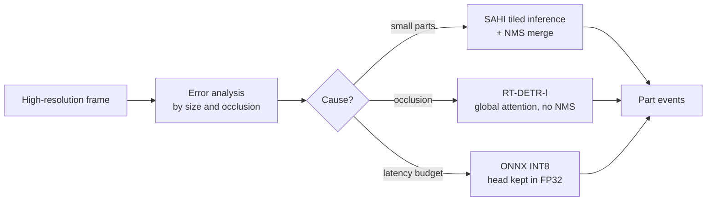

# Lab 02 · Small and Occluded Object Detection


> **Object detection that misses occluded or tiny parts.**
> A reproducible proof of concept (PoC) that diagnoses *why* a detector fails and measures the cheapest fix for each failure: tiled inference (SAHI) for small objects, RT-DETR for occlusion, and INT8 quantization for latency.

Part of the **Computer Vision Reference Architectures** series. This is the code behind the article *"Object Detection That Misses Occluded or Tiny Parts"*.

---

## Table of contents

- [The business problem](#the-business-problem)
- [What this lab does](#what-this-lab-does)
- [Architecture](#architecture)
- [Components](#components)
- [Quick start](#quick-start)
- [Configuration](#configuration)
- [What to expect](#what-to-expect)
- [Optional: retraining with targeted augmentation](#optional-retraining-with-targeted-augmentation)
- [Project structure](#project-structure)
- [Scope and limitations](#scope-and-limitations)
- [Troubleshooting](#troubleshooting)
- [References](#references)

---

## The business problem

A contract electronics manufacturer documents every unit on its assembly lines with a camera and a one-stage detector (YOLO type). It works when the scene is clear. It fails when:

- a robotic arm or tool **covers part of the component** (occlusion),
- the part is **so small** it is barely visible,
- the background is **cluttered**.

An unlogged part becomes rework, a customer return, or an audit penalty, because without a record of every part there is no traceability.

The architecture decision is **what to do before reacting**. Buying licenses or replacing the model without knowing why it fails can cost a lot and leave the problem unchanged. The right question is *in exactly which cases it fails and what the cheapest fix is for each.*

## What this lab does

Three experiments, each answering one question:

| # | Question | Method |
|---|---|---|
| 1 | Does tiled inference help with small objects? | YOLOv8n on the full frame vs YOLOv8n + SAHI tiles, on 16 synthetic scenes built from labeled COCO128 images |
| 2 | Does a transformer detector handle occlusion better? | YOLOv8n vs RT-DETR-l on images where 40% to 60% of some objects is covered by a synthetic "robotic arm" |
| 3 | What does INT8 quantization cost and gain? | CPU latency (p50 / p95) for PyTorch vs ONNX FP32 vs ONNX INT8, plus the AP50 cost |

## Architecture



Why a single cause is not enough: six mechanisms combine depending on the scene (input downsampling, grid assignment, NMS, limited local context, object-background imbalance, and invariance that is only learned). Each has a different fix, which is why the lab diagnoses by segment first.

## Components

| File | Role |
|---|---|
| `detection/run.py` | Main experiment. Loads models, runs the three experiments, exports to ONNX, quantizes to INT8, writes metrics and figures |
| `detection/data.py` | Builds the datasets from COCO128: small-object scenes on a conveyor-style canvas and the synthetic occlusion set |
| `detection/metrics.py` | Own implementation of AP50 (per class, all-point interpolation), recall, small-object recall, and recall on a subset |
| `detection/train_demo.py` | Optional retraining with targeted augmentation (GPU recommended) |
| `common/utils.py` | Paths, cached downloads, `metrics.json` metadata, and optional MLflow / MinIO integrations |

Implementation notes worth knowing:

- **SAHI** is implemented in `sliced_predict`: overlapping native-resolution tiles (640 px, 20% overlap) plus one full-frame pass, merged with per-class NMS.
- **INT8** uses static quantization (QDQ format) with calibration images. Only `Conv` ops are quantized, so the decoding head stays in FP32.

## Quick start

### Requirements

- Docker with Compose v2
- About **8 GB of memory** assigned to Docker
- Internet access on the first run. It downloads COCO128 and the `yolov8n` and `rtdetr-l` weights (GitHub releases)
- No GPU needed for the default run

### 1. Configure

```bash
cp .env.example .env
```

The defaults work as they are. The `.env` file is git-ignored.

### 2. Run

**Linux / macOS / WSL:**

```bash
bash run.sh
```

**Windows PowerShell:**

```powershell
powershell -ExecutionPolicy Bypass -File .\run.ps1
```

**Or step by step (any OS):**

```bash
docker compose build
docker compose run --rm detection
```

Downloaded datasets and weights are cached in `./cache`, so later runs are faster. RT-DETR is slow on CPU. Expect the full run to take a while.

## Configuration

Set these in `.env`:

| Variable | Default | What it does |
|---|---|---|
| `DET_SCENES` | `16` | Number of small-object scenes |
| `DET_OCCLUSION_IMAGES` | `64` | Number of images in the occlusion set |
| `DET_RTDETR` | `1` | Set to `0` to skip RT-DETR (it is slow on CPU) |
| `DET_CONF` | `0.25` | Detection confidence threshold |
| `EPOCHS` / `DEVICE` | `3` / `cpu` | Only for the optional training job |
| `MLFLOW_TRACKING_URI`, `MINIO_ENDPOINT` | *(unset)* | Optional integrations. The lab runs without them |

## What to expect

Everything is written to `results/detection/`:

| File | Content |
|---|---|
| `metrics.json` | All metrics, plus a `_meta` block with parameters, library versions, and machine |
| `sahi_comparison.png` | Same scene, full frame vs SAHI tiles, with detections drawn |
| `occlusion_example.png` | Occluded objects (green) vs each model's detections (red) |
| `latency.png` | p95 CPU latency per model against the assumed 50 ms budget |

### Results from the reference run

16 scenes (1,066 objects, 502 of them small), plus 64 occlusion images with 110 occluded objects. Latencies measured on a workstation CPU.

| Action | Metric | As-is | To-be |
|---|---|---|---|
| SAHI on small parts | AP50 | 0.25 | **0.42** |
| SAHI on small parts | Recall of small objects | 1.8% | **18.5%** |
| RT-DETR under occlusion | Recall of occluded objects | 16% | **35%** |
| RT-DETR under occlusion | Recall of unoccluded objects | 73% | 97% |
| RT-DETR under occlusion | AP50 on occluded images | 0.27 | **0.51** |
| INT8 quantization (ONNX) | p95 latency on CPU | 48 ms (FP32) | **28 ms** |
| INT8 quantization (ONNX) | Model size | 12.8 MB | **3.6 MB** |

**How to read it:**

- For a line running at 20 fps, the working assumption is a **50 ms budget per frame**.
- On this CPU, ONNX FP32 was slower than PyTorch (48 vs 35 ms), so against PyTorch the INT8 gain is about 18%, not 41%.
- INT8 costs about 4 points of AP50 (0.59 to 0.55).
- RT-DETR took about 400 ms per image (p95 408 ms), roughly eight times the budget. It would need a GPU or optimization.
- Even with SAHI, recall of small parts is 18.5%. It doubled AP50, but most small parts still go undetected.

> Latency depends on your CPU. Measure on the target hardware, at p95, before concluding anything.

## Optional: retraining with targeted augmentation

Targeted augmentation (random erasing, mosaic, copy-paste) simulates occlusion and background variety. It is **not part of the default run** and needs a GPU:

```bash
docker compose --profile gpu run --rm training
```

Training outputs go to `results/detection/train/`. This step was **not run** in the reference PoC.

## Project structure

```text
lab-02-object-detection-occlusion/
├── detection/
│   ├── run.py             # experiment entry point
│   ├── data.py            # COCO128-based datasets
│   ├── metrics.py         # AP50 and recall
│   └── train_demo.py      # optional GPU retraining
├── common/utils.py        # shared helpers
├── results/               # outputs (git-ignored, .gitkeep kept)
├── cache/                 # datasets and weights (git-ignored, .gitkeep kept)
├── Dockerfile
├── docker-compose.yml
├── requirements.txt
├── .env.example
├── run.sh / run.ps1
└── README.md
```

## Scope and limitations

| In scope | Out of scope |
|---|---|
| Scenes with small parts built from COCO128 | Real data from an assembly line |
| Synthetic occlusion of 40% to 60% of the object | Real occlusion by a robotic arm or operator |
| YOLOv8n on the full frame vs YOLOv8n + SAHI | Distillation and pruning (require a GPU) |
| YOLOv8n vs RT-DETR-l under occlusion | Latency on the plant's actual hardware |
| CPU latency: PyTorch, ONNX FP32, and INT8 | Results of retraining with targeted augmentation |

Caveats:

- The occlusion sample is small (110 occluded objects, RT-DETR found 38 and YOLOv8n found 18). It is a **directional** result.
- RT-DETR also improved on unoccluded objects (73% to 97%), so part of its advantage comes from being a stronger detector on these scenes, not only from handling occlusion better.
- The PoC applied SAHI to the whole scene. A production design would limit it to small-part zones with a zone router.
- The tracker proposed in the article was **not** measured here.

## Troubleshooting

| Problem | What to do |
|---|---|
| Build fails | Check Docker memory (about 8 GB) and internet access. Keep the last 30 lines of the error |
| Run is very slow or runs out of memory | Set `DET_RTDETR=0`, or lower `DET_SCENES` and `DET_OCCLUSION_IMAGES` |
| COCO128 or weights fail to download | Re-run. Downloads are cached in `./cache` |
| ONNX / INT8 step fails | The lab logs `Quantization skipped` and continues with the rest of the metrics |
| `permission denied` on `run.sh` | Run it with `bash run.sh` |

## References

- Akyon, F. C., Altinuc, S. O., & Temizel, A. (2022). Slicing aided hyper inference and fine-tuning for small object detection. *2022 IEEE ICIP* (pp. 966–970). https://doi.org/10.1109/ICIP46576.2022.9897990
- Zhao, Y., Lv, W., Xu, S., Wei, J., Wang, G., Dang, Q., Liu, Y., & Chen, J. (2024). DETRs beat YOLOs on real-time object detection. *CVPR 2024* (pp. 16965–16974). https://doi.org/10.1109/CVPR52733.2024.01605
- Bodla, N., Singh, B., Chellappa, R., & Davis, L. S. (2017). Soft-NMS: Improving object detection with one line of code. *ICCV 2017* (pp. 5561–5569). https://doi.org/10.1109/ICCV.2017.593
- Lin, T.-Y., Goyal, P., Girshick, R., He, K., & Dollár, P. (2017). Focal loss for dense object detection. *ICCV 2017* (pp. 2980–2988). https://doi.org/10.1109/ICCV.2017.324

---

